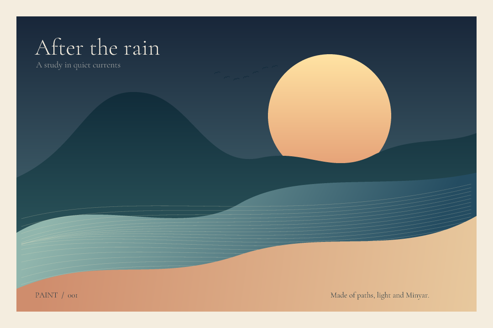
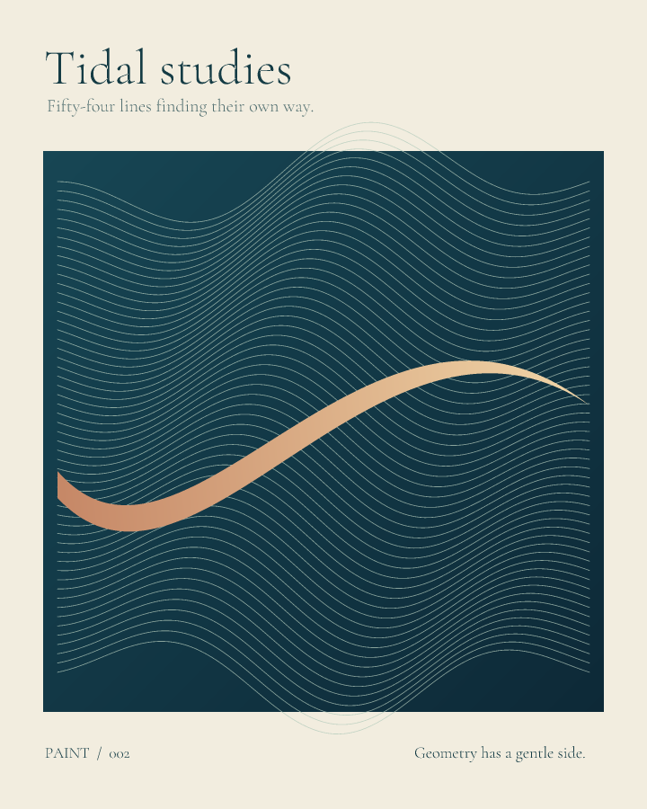
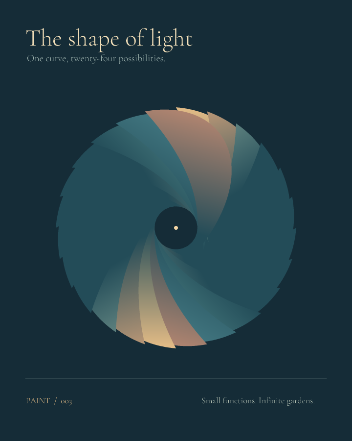

# paint

A small vector studio, written in Minyar. Paths become pictures. The same
geometry produces antialiased PNGs and editable, self-contained SVGs.



```sh
minyar add github.com/O4FDev/paint@v0.1.0
```

The repository is prepared locally for `github.com/O4FDev/paint`; it has not
been published. See the unpublished-install instructions below until it is.

```minyar
use "paint" as paint

let picture = paint.canvas(640, 480)
paint.clear(picture, paint.rgb(0x152c37))
paint.fillGradient(picture, paint.circle(320.0, 240.0, 140.0),
    paint.linear(180.0, 100.0, 460.0, 380.0,
        paint.rgb(0xffdf9a), paint.rgb(0xc98970)))
paint.writePng(picture, "hello.png")
paint.writeSvg(picture, "hello.svg")
```

## Draw

- `path`, `moveTo`, `lineTo`, `quadraticTo`, `cubicTo`, `close` build contours.
- `circle` and `rectangle` make paths; `transformed` applies an affine matrix.
- `fill` uses an even-odd rule, including holes and multiple contours.
- `fillGradient` uses a two-stop linear gradient in canvas coordinates.
- `stroke` has round caps and joins. One coverage mask prevents translucent
  overlaps from darkening at joins.
- `rgb(0xRRGGBB)`, `rgba(r, g, b, a)` and `opacity` describe ink.
- `loadFont`, `textWidth`, `textPath` and `text` turn TrueType outlines into paths.
- `pixels` returns straight-alpha RGBA bytes; `pngBytes`, `writePng`, `svg` and
  `writeSvg` export the image.

Coordinates and sizes use `Float`; the origin is at the top left. Text uses a
baseline. Color channels and opacity range from 0.0 to 1.0. Gradients interpolate
encoded RGB channels. Painting uses source-over composition. `clear` resets both
the bitmap and the SVG scene.

`canvas` uses a 3 × 3 sample grid per pixel. `canvasWithSamples(w, h, samples)`
accepts 1 through 4 samples per axis, dimensions up to 4096, and at most 16 million
supersampled pixels (64 MiB for the color buffer). Strokes temporarily allocate
another buffer of that size. PNG export allocates output pixels, filtered rows
and a compressed stream. There are no GPU, windowing, image-codec or font-engine
dependencies. Math and file I/O use the standard Minyar modules.

Curves flatten adaptively for rasterization; SVG retains original Bézier commands.
Affine transforms currently export flattened paths. PNG encoding uses a pure
Minyar Sub filter, LZ77, fixed Huffman DEFLATE, Adler-32 and PNG CRC-32. It is
deterministic, lossless RGBA8, with no external codec and no metadata timestamps.

TrueType supports Unicode cmap formats 4/12, short/long locations, simple
quadratic contours and translated/scaled/rotated composite glyphs. Font hinting
instructions are never executed. CFF/OTF/TTC, point-attached composites,
variation-axis selection, kerning, shaping, ligatures and bidirectional layout
are not implemented. Missing characters use the font's missing-glyph outline.
For shaped scripts, provide positioned outlines from another layout system.
The included Cormorant Garamond font has its own [OFL license](assets/OFL.txt).

## Make the gallery

From this repository root, with Minyar on PATH:

```sh
minyar test
minyar test --release
minyar --library src examples/after-rain.min -o target/after-rain
./target/after-rain
minyar --library src examples/tidal.min -o target/tidal
./target/tidal
minyar --library src examples/bloom.min -o target/bloom
./target/bloom
python3 scripts/check-gallery.py
```




The gallery's expected pixel digests accompany an independent standard-library
PNG decoder. Tests cover compositing, coverage, holes, stroke joins, TrueType
metrics/composites and generated PNG framing. Examples do not access the network.

## Install before publication

Create a private bare mirror and keep the GitHub-shaped import:

```sh
mkdir -p /tmp/minyar-mirror/github.com/O4FDev
git clone --bare "$PWD" /tmp/minyar-mirror/github.com/O4FDev/paint.git
cd /path/to/a/minyar/project
MINYAR_GIT_MIRROR=/tmp/minyar-mirror minyar add github.com/O4FDev/paint
minyar run --locked --offline
```

No global Git configuration or remote is changed. The manifest and content lock
record the final GitHub path, ready for publication. Consumers need Minyar with
Git dependency support.

## Publish later

Luke can create the public repository and push the already-tested main branch
and `v0.1.0` tag with this single command:

```sh
MINYAR_CONFIRM_PUBLISH=github.com/O4FDev/paint sh scripts/publish.sh
```

That script has not been run. It requires GitHub CLI authentication and an
explicit destination match. Package code and artwork are MIT licensed; the
unmodified bundled font remains under OFL 1.1.
